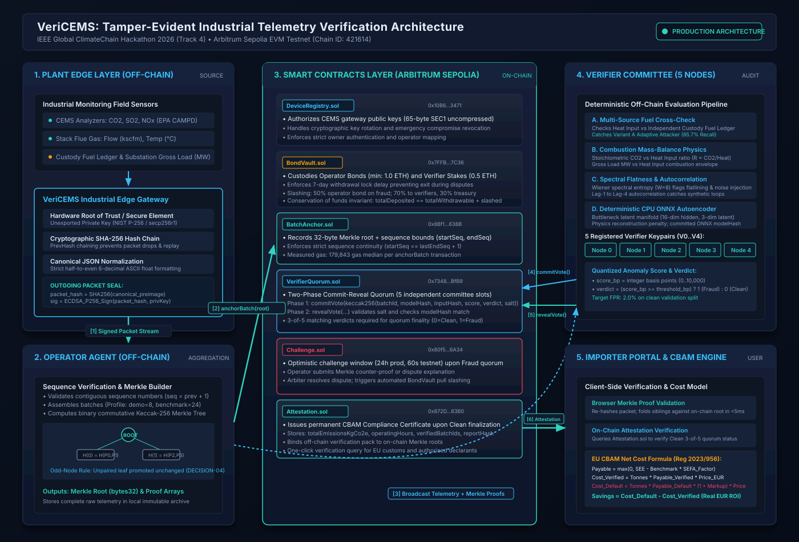

# VeriCEMS System Architecture & Data-Flow Specification

> **Document Class:** Technical Architecture & Cryptographic Data Flow  
> **Source Diagram Files:** [`docs/architecture.mmd`](file:///c:/Users/LENOVO/Documents/Hackathons/IEEE%20Climate%20Change/docs/architecture.mmd), [`docs/architecture.svg`](file:///c:/Users/LENOVO/Documents/Hackathons/IEEE%20Climate%20Change/docs/architecture.svg), [`docs/architecture.png`](file:///c:/Users/LENOVO/Documents/Hackathons/IEEE%20Climate%20Change/docs/architecture.png)  
> **Target Network:** Arbitrum Sepolia (`Chain ID: 421614`)  
> **Standards Alignment:** Informed by IEEE 2413-2019 (IoT Architecture), IEEE P3218 (Blockchain for Carbon Trading), IEEE P3219 (Zero-Trust IoT Framework), and IEEE P2418.1 (Blockchain for Connected IoT Devices).

---

## 1. High-Level Architecture Overview

VeriCEMS implements a multi-tier, zero-trust verification pipeline for industrial continuous emission monitoring systems (CEMS). Rather than trusting raw emissions numbers reported by plant computers, VeriCEMS cryptographically binds telemetry at the physical edge, verifies physical combustion relationships across independent verifiers, and anchors proof trees onto an EVM Layer-2 ledger.



---

## 2. On-Chain vs. Off-Chain Partitioning Table

The architecture strictly minimizes expensive on-chain gas costs while preserving cryptographic non-repudiation and decentralized verification.

| Component / Layer | Execution Location | Storage Location | State & Data Objects | Gas / Compute Profile | Trust & Security Properties |
|---|---|---|---|---|---|
| **CEMS Edge Gateway** | Physical Plant Edge | Local Secure Hardware Memory | Private Key (NIST P-256), `PrevHash`, Sequence Counter | Low compute; sub-millisecond signing per reading | Device key isolated in secure element; PrevHash chaining prevents history deletion or packet reordering. |
| **Operator Ingestion Node** | Operator Cloud / Premises | Operator Database & Disk Archive | Full raw telemetry packets, canonical JSON pre-images, full Merkle trees | Batch aggregation; Keccak-256 tree construction ($O(N)$) | Untrusted; cannot forge device signatures or modify packets without breaking Merkle proofs. |
| **`DeviceRegistry.sol`** | EVM Layer-2 (Arbitrum Sepolia) | Contract Storage | Device ID (`bytes32`), 65-byte uncompressed SEC1 public key, active status | One-time write: 238,041 gas; view reads: 0 gas | Owner-gated authentication; immutable device key registry with explicit revocation. |
| **`BondVault.sol`** | EVM Layer-2 (Arbitrum Sepolia) | Contract Storage | Operator bond deposits, Verifier stakes, withdrawal lock timestamps | Deposit: 55,111–117,845 gas; Slashing: internal contract call | Non-custodial escrow; mandatory 7-day withdrawal lock delay enforces stake accountability during disputes. |
| **`BatchAnchor.sol`** | EVM Layer-2 (Arbitrum Sepolia) | Contract Storage & Logs | `batchId`, `merkleRoot` (`bytes32`), `startSeq`, `endSeq` | Median 179,843 gas per batch anchor | Sequential ordering invariant (`startSeq == lastEndSeq + 1`); roots are immutable once anchored. |
| **Verifier Nodes (5 Committee Members)** | 5 Independent External Servers | Verifier Memory / Ephemeral Cache | Cached ONNX model weights, scalar normalization parameters, incoming raw batch telemetry | CPU inference: ~1.2 ms per batch; stoichiometric mass-balance checks | 5 independent organizations; colluding threshold requires 3+ compromised verifiers. |
| **`VerifierQuorum.sol`** | EVM Layer-2 (Arbitrum Sepolia) | Contract Storage & Events | Vote commitments (`bytes32`), revealed salt/verdict/score, quorum finality | `commitVote`: 103,410 gas; `revealVote`: 177,505 gas; `finalize`: 188,177 gas | Commit-reveal scheme prevents front-running and vote copying; 3-of-5 threshold gates finality. |
| **`Challenge.sol`** | EVM Layer-2 (Arbitrum Sepolia) | Contract Storage | Open challenge records, dispute states, operator counter-proofs | `openChallenge`: 120,654 gas; `resolve`: 198,309 gas | Optimistic challenge window (24h prod, 60s testnet); arbiter verifies Merkle inclusion of contested packets. |
| **`Attestation.sol`** | EVM Layer-2 (Arbitrum Sepolia) | Contract Storage | `totalEmissionsKgCo2e`, `operatingHours`, `verifiedBatchIds[]`, `reportHash` | One-time write: 281,626 gas; view reads: 0 gas | Permanent, publicly queryable CBAM compliance record linked to verified on-chain batches. |
| **Importer Portal & CBAM Calculator** | EU Importer Web Browser | Client Memory & Local Storage | Period summary report JSON, Merkle sibling proofs, CBAM benchmark parameters | Client-side computation; Merkle proof verification: <5 ms | Independent browser validation; verifies packet membership against on-chain root with zero server trust. |

---

## 3. End-to-End Data Flow

The complete data lifecycle progresses through seven sequential stages:

```
[Edge Gateway] --(1: Signed Packets)--> [Operator Agent] --(2: Merkle Root)--> [BatchAnchor.sol]
                                               |
                                        (3: Raw Batch + Proofs)
                                               v
                                    [5 Verifier Nodes]
                                         |         |
                          (4: commitVote)          (5: revealVote)
                                         v         v
                                    [VerifierQuorum.sol]
                                         /         \
                         (Clean Quorum) /           \ (Fraud Quorum)
                                       v             v
                              [Attestation.sol]   [Challenge.sol] --> [BondVault.sol Slashing]
                                       |
                              (6: Verify Attestation)
                                       v
                              [Importer Portal]
```

### Step 1: Edge Telemetry Ingestion and Signing
- **Physical Sampling:** The stack analyzer samples gas concentrations (`co2_mass_short_tons`, `so2_mass_lbs`, `nox_mass_lbs`), stack flow, and flue temperature at regular intervals (1-minute averages in production, hourly in EPA CAMPD benchmark).
- **Canonical Formatting:** The edge gateway formats telemetry into canonical JSON pre-images. Floating-point numbers are rounded half-to-even to strictly 6 decimal places (`"0.000000"`) per DECISION-02 in `docs/INTERFACES.md`.
- **Cryptographic Chaining:** The gateway computes `packet_hash = SHA256(canonical_preimage)` and signs `packet_hash` using its private key on the NIST P-256 curve (`secp256r1`). The packet embeds `prev_hash`, binding each reading to the preceding packet in an immutable chain.

### Step 2: Batch Aggregation and Root Anchoring
- **Sequence Verification:** The operator node receives signed packets, checks contiguous sequence increments (`seq == last_seq + 1`), and verifies that `prev_hash` matches the prior packet's hash.
- **Merkle Tree Construction:** Packets are grouped into batches ($N = 24$ hourly packets for benchmark profile; $N = 8$ for demo profile). A binary Merkle tree is computed using OpenZeppelin-compatible commutative Keccak-256 leaf hashing (`leaf = keccak256(bytes.concat(keccak256(canonical_bytes)))`).
- **Odd-Node Handling:** If a tree level contains an odd number of nodes ($2k + 1$), the final node is promoted unchanged to the next level without duplicate hashing (DECISION-04).
- **On-Chain Anchoring:** The operator invokes `BatchAnchor.anchorBatch(batchId, merkleRoot, startSeq, endSeq)`. `BatchAnchor` verifies that the operator is bonded in `BondVault.sol` and that `startSeq == lastEndSeq + 1`.

### Step 3: Verifier Committee Ingestion & Deterministic Inference
- **Batch Broadcast:** The operator broadcasts the raw batch packets, the Merkle tree, and device signatures off-chain to all 5 registered verifier committee nodes.
- **Signature Verification:** Each verifier node verifies that all packet signatures match the gateway public key registered in `DeviceRegistry.sol`.
- **Detector Pipeline:** Verifiers execute four deterministic detection modules:
  1. *Multi-Source Cross-Check:* Compares CEMS Heat Input against an independent custody-transfer fuel meter (`fuel_ledger_synthetic`).
  2. *Stoichiometric Mass Balance:* Checks combustion stoichiometry ($R = \text{CO}_2 / \text{Heat Input}$) and electric generation efficiency ($Gross Load / Heat Input$).
  3. *Spectral Flatness & Autocorrelation:* Evaluates Wiener spectral entropy and lag autocorrelations over rolling windows ($W = 8$) to detect sensor flatlining and replay loops.
  4. *Physics-Informed Autoencoder:* Runs deterministic ONNX CPU inference to compute mean squared reconstruction error against learned normal operational manifolds.
- **Score Quantization:** Anomaly scores are quantized to integer basis points ($0 \dots 10,000$). If `score_bp >= threshold_bp`, the verifier assigns `verdict = 1` (Fraud); otherwise `verdict = 0` (Clean).

### Step 4: Two-Phase Commit-Reveal Quorum Voting
- **Phase 1 (Commit):** Each verifier generates a random 32-byte salt and computes:
  $$\text{commitment} = \text{keccak256}(\text{abi.encode}(\text{batchId}, \text{modelHash}, \text{inputHash}, \text{scoreBp}, \text{verdict}, \text{salt}))$$
  Each verifier submits `commitment` to `VerifierQuorum.commitVote(batchId, commitment)`. Committing sealed hashes prevents front-running, collusion, and lazy vote copying.
- **Phase 2 (Reveal):** Once the commit window elapses (15 minutes in benchmark, 30 seconds in demo), verifiers submit `revealVote(batchId, modelHash, inputHash, scoreBp, verdict, salt)`.
- **Quorum Finalization:** `VerifierQuorum.sol` checks that the unsealed parameters reproduce the committed hash. Once 3 matching verdicts are revealed:
  - If **Clean** (`verdict = 0`), the batch status advances to `Verified`.
  - If **Fraud** (`verdict = 1`), the batch status advances to `Flagged`, initiating an optimistic challenge.

### Step 5: Optimistic Challenge and Slashing
- **Dispute Window:** A flagged fraud finding triggers `Challenge.sol` and opens a dispute window (24 hours in benchmark profile; 60 seconds in testnet profile).
- **Operator Dispute:** The operator may submit Merkle counter-evidence (`submitOperatorDispute`) showing valid calibration certificates or sensor self-tests.
- **Arbiter Settlement:** An accredited verification body arbiter inspects the contested packets. If fraud is upheld:
  - `BondVault.sol` slashes **50% of the operator's bond** (5,000 basis points).
  - 70% of the slashed bond is distributed pro-rata to honest majority verifiers as economic bounty.
  - 30% of the slashed bond routes to the protocol treasury.
  - The flagged batch is marked permanently invalid.
- If the fraud finding was a careless false alarm, careless verifiers lose 10% of their stake (`carelessVerifierSlashBps = 1000`).

### Step 6: Attestation Issuance
- When all batches in a compliance period (e.g., month or quarter) reach `Verified` status, the operator or lead verifier calls `Attestation.recordAttestation(...)`.
- `Attestation.sol` records the cumulative emissions (`totalEmissionsKgCo2e`), total operating unit-hours, array of verified batch IDs, and the SHA-256 digest of the off-chain period report (`reportHash`).

### Step 7: Importer Verification and Cost Calculation
- **Client-Side Verification:** The EU importer connects their web browser to `web/` and loads the exporter's attestation ID.
- **Cryptographic Proof Check:** The browser fetches the on-chain Merkle root and validates individual shipment packet proofs locally using client-side JavaScript.
- **Net CBAM Liability Calculation:** The CBAM calculator computes:
  $$\text{SEFA} = \text{Benchmark} \times \text{FreeAllocationFactor} \times \text{CSCF}$$
  $$\text{Payable}_{\text{verified}} = \max(0, \text{SEE}_{\text{verified}} - \text{SEFA})$$
  $$\text{Cost}_{\text{verified}} = \text{Tonnes} \times \text{Payable}_{\text{verified}} \times \text{Price}_{\text{EUR}}$$
  $$\text{Cost}_{\text{default}} = \text{Tonnes} \times \max(0, \text{Default}_{\text{base}} \times (1 + \text{Markup}) - \text{SEFA}) \times \text{Price}_{\text{EUR}}$$
  The importer views the verifiable cost savings in EUR, exporting the verified proof pack directly for EU customs clearance.
